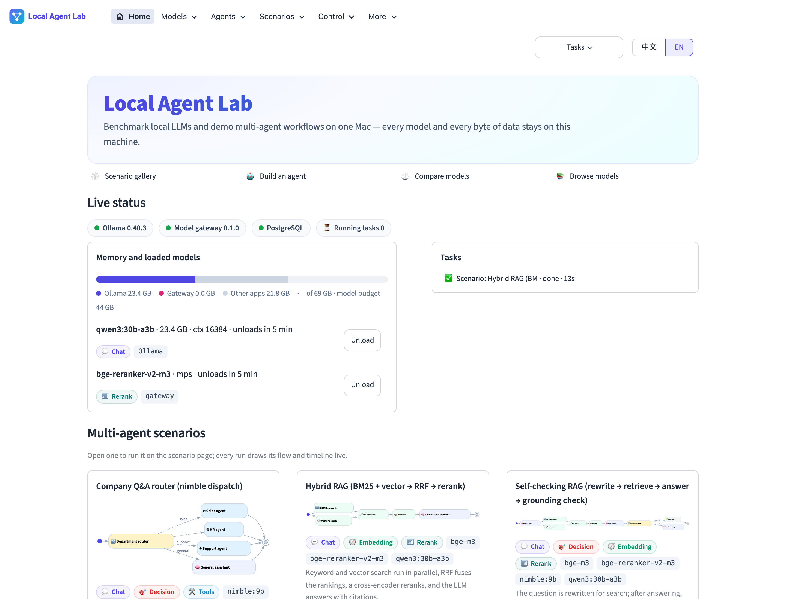
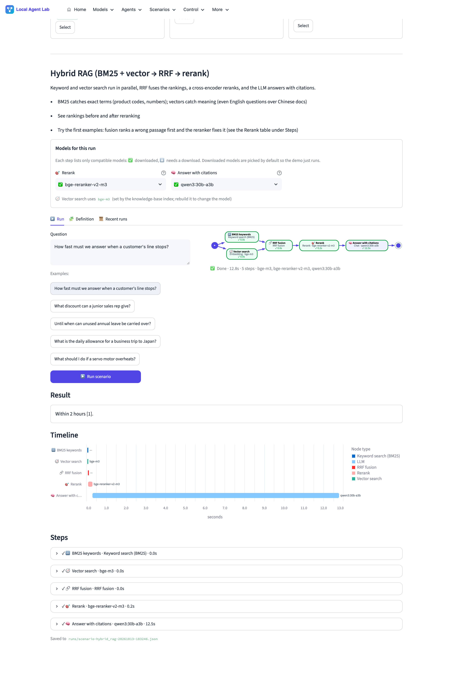
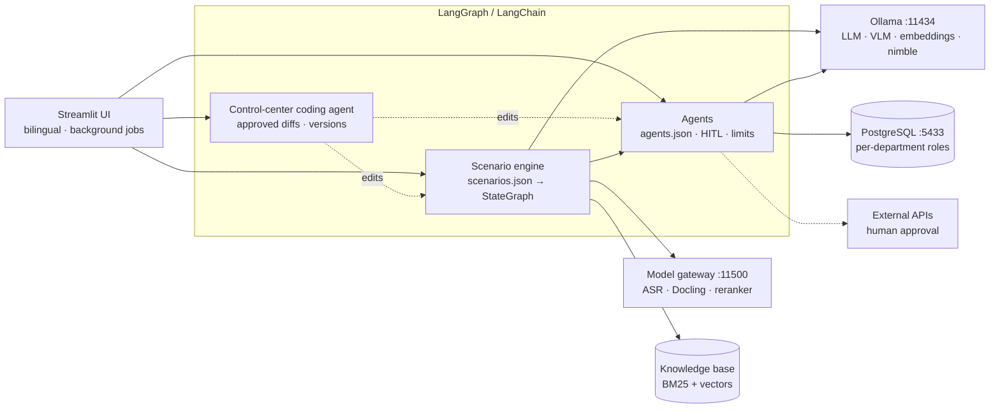
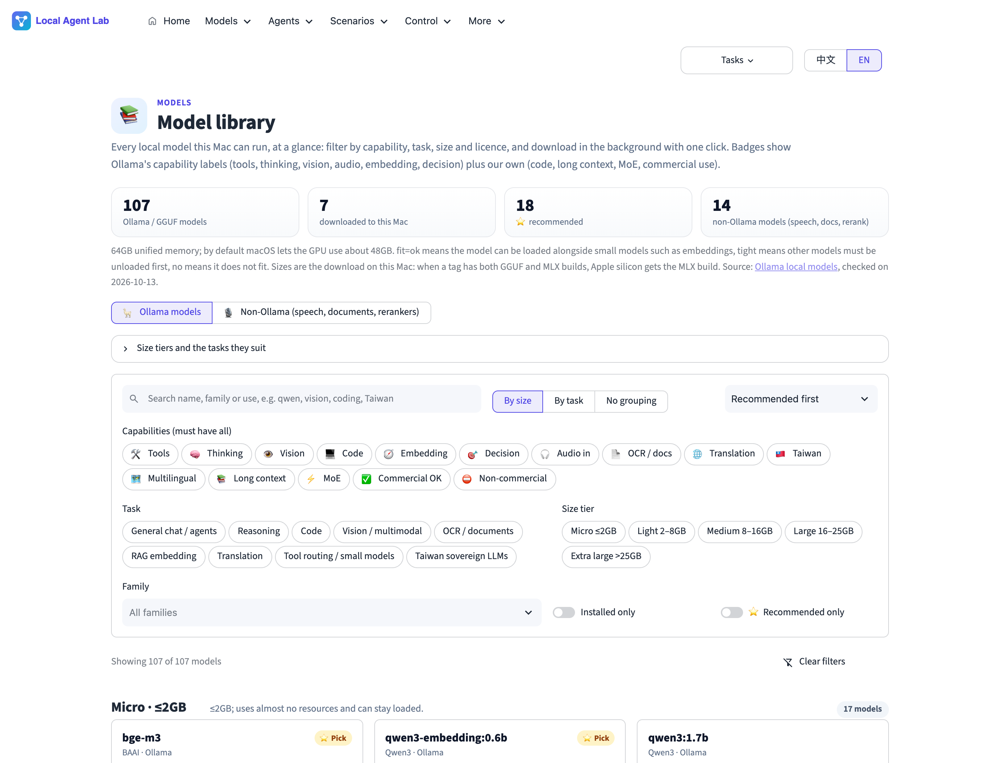
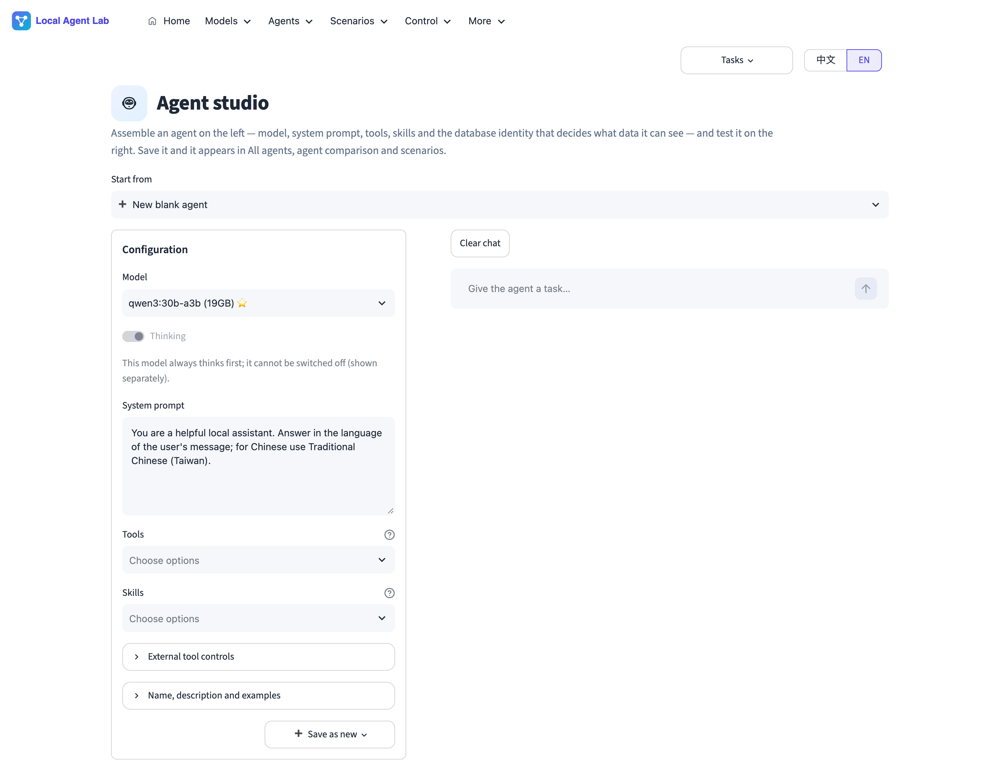
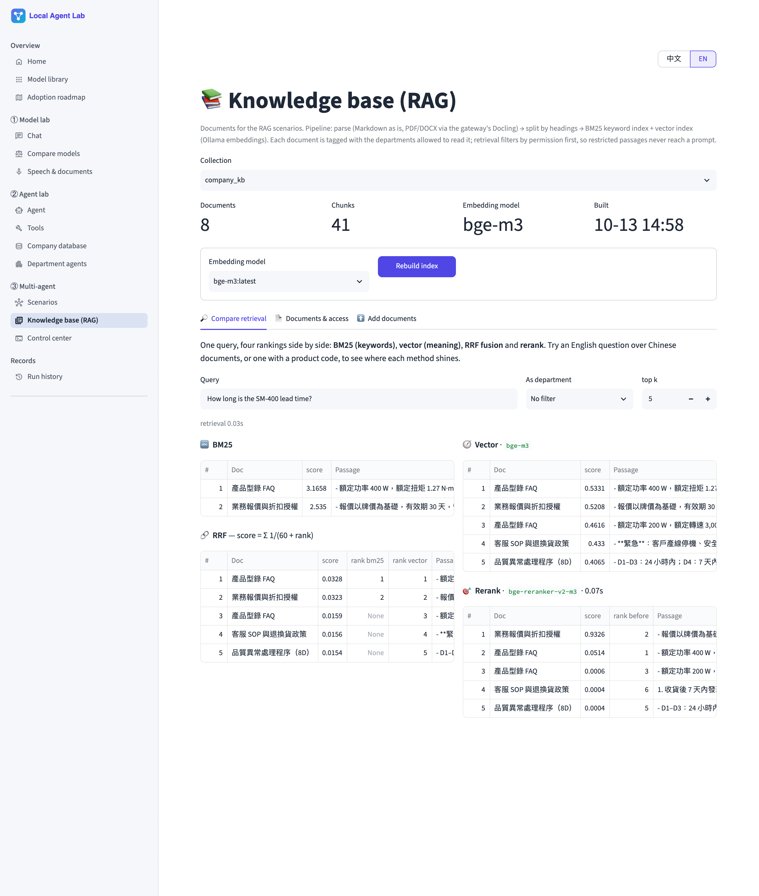
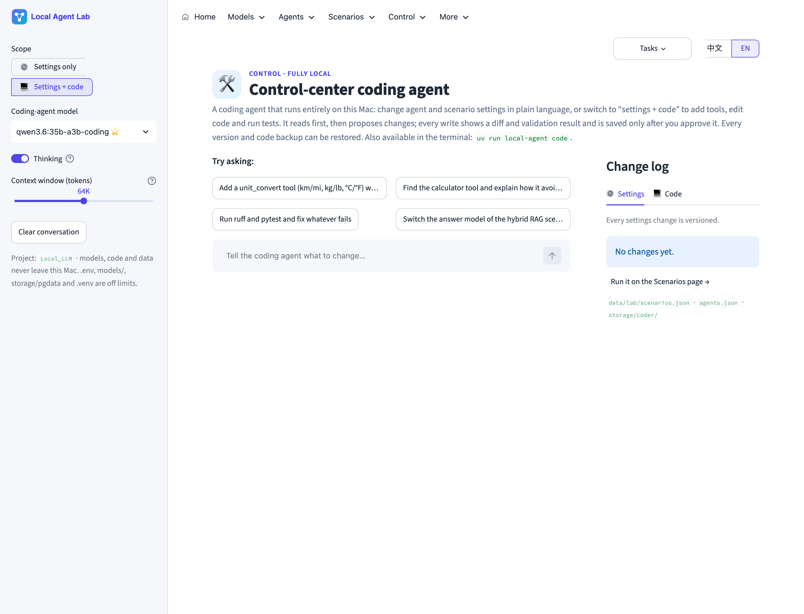
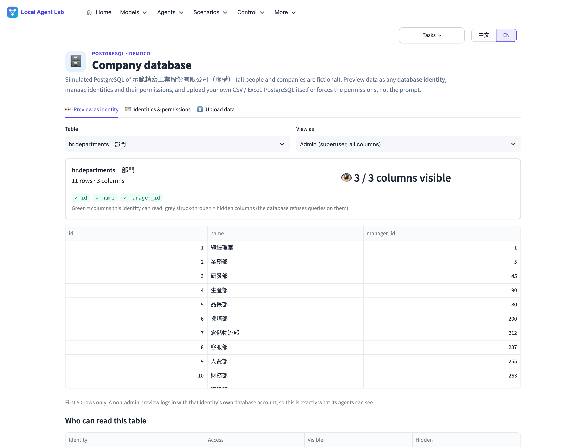
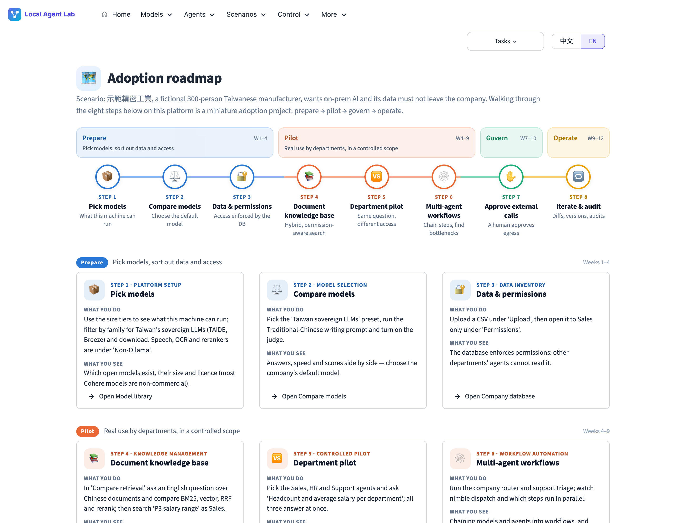

# Local Agent Lab

**Benchmark local LLMs and demo multi-agent scenarios on a single Mac — every model and every
byte of data stays on the machine.**

[繁體中文說明 → README.zh-TW.md](README.zh-TW.md)



Local Agent Lab is a Streamlit workbench built on Ollama, LangChain 1.x / LangGraph, a small
self-built model gateway (speech, document parsing, reranking), and PostgreSQL. It does two
things:

1. **Benchmark local LLMs.** Browse 107 local models with capability tags (tools, thinking,
   vision, code, embedding, decision, ASR, OCR, rerank, Taiwan-tuned, licence…), download them
   with one click, and compare up to six models side by side on the same prompt (answers, time
   to first token, tokens/s, an optional LLM judge). Speech models have their own comparison
   page: transcripts with CER (also under noise and telephone audio), Chinese-to-English
   translation (cascade, audio LLM, Whisper, plus a live-input simulation) and meeting speaker
   diarization with DER. The home page shows which models are loaded, how much memory they use
   and which tasks are running.
2. **Demo multi-agent scenarios.** Nine ready-made workflows run as LangGraph graphs: routing
   with a decision model, hybrid RAG, self-checking RAG, permission-aware retrieval, meeting
   audio → minutes, contract review, support triage, a mixture of agents, and an analyst →
   writer → translator pipeline. Each run has a live flow diagram and a timeline, and every
   step's model can be swapped for a compatible one (downloaded models are the default). Build
   agents in the **Agent studio** (model, system prompt, tools, skills, database identity), ask
   several agents the same question, and let a **fully local coding agent** change agents,
   scenarios or code — every change is approved as a diff and can be rolled back.

The UI is bilingual (中文 / EN, switch in the top-right corner). The demo company and all of
its data are fictional.

## What's new (2026-10-19)

- **True streaming ASR**: Voxtral 4B Realtime (4-bit), sherpa-onnx Zipformer (zh-en, zh) and streaming Paraformer. Live mode compares true streaming with chunked simulation, and adds **live microphone captions** over a local WebSocket.
- **Taiwanese Hokkien**: MediaTek Breeze-ASR-26 added; the Hokkien sample can be scored against the dictionary's 漢字 or its Mandarin translation.

## 2026-10-16

- **Speech comparison** gains three modes: live captions (simulated streaming), text to speech (macOS system voices, with a transcription round-trip check) and voice chat (speech → text → LLM → speech). Transcription adds Taiwanese Hokkien, an English audiobook, Taiwanese-accented English and a real multi-speaker meeting (AliMeeting) as samples; English is scored by word error rate (WER).
- **Model library**: 107 non-Ollama models now cover streaming ASR, TTS, voice chat, speech translation, voice activity detection and diarization (listed only, not yet downloadable).

## Earlier (2026-10-15)

- **Speech model comparison** is its own page now, separate from the LLM comparison. It has three modes:
  - Transcribe: character error rate, optionally with added noise or telephone audio.
  - Translate: Chinese speech to English, comparing ASR → LLM, audio-LLM direct and Whisper translate, including a live-input simulation.
  - Meeting: who spoke when, plus a speaker-labelled transcript.
- **Speech models**: the gateway now serves 10 ASR models and 1 speaker-diarization model.
  - ASR: Breeze-ASR-25, Whisper large-v3 and v3-turbo, Qwen3-ASR 1.7B and 0.6B, SenseVoice, Fun-ASR-Nano, the Ministry of Digital Affairs' Taiwan-Tongues, and Gemma 4 E2B and E4B.
  - Speaker diarization: pyannote plus 3D-Speaker.
- **Real test recording**: an excerpt of the 2026 National Day address, courtesy of the Office of the President. It is 4 min 29 s, read from the official text, with that text and its official English translation, so error rates can be scored against it.
- **Meeting minutes scenario**: diarizes first, then transcribes, so action items name who raised them.
- **Coding agent**: conversations are saved and can be resumed, on the web page or with `local-agent code --resume`.
- **UI**:
  - The model library is a list.
  - Chat settings sit above the conversation.
  - The scenario picker is compact.
  - One Material icon set is used throughout.
- **Run history**: delete one or many runs; deleted runs go to a trash folder you can restore from.

## Highlights

| | |
|---|---|
| **Live scenario tracing** | A Graphviz diagram shows each node's status, model, timing, and the router branch taken (with probabilities). An Altair waterfall shows what ran in parallel and where the time went. |
| **Decision-model routing** | `nimble:9b` (Ollama `/v1/systemone`) answers typed questions (choice / score / yes-no) with probabilities in ~0.3–3 s. It is used for department dispatch, ticket triage, and grounding checks. |
| **Hybrid, permission-aware RAG** | BM25 (CJK bigrams) and bge-m3 vectors run in parallel, then RRF, then a bge-reranker-v2-m3 cross-encoder. Documents carry department tags, and restricted passages are filtered out *before* they can reach a prompt. |
| **Model gateway** | Ollama-like download / lazy-load / idle-unload and OpenAI-style endpoints for models Ollama can't serve: Breeze-ASR-25 (Taiwanese Mandarin ASR), Whisper, Docling, rerankers. |
| **Governed agents** | Database permissions are enforced by PostgreSQL roles, not by prompts. External APIs are off by default and capped per run, and each call needs human approval. |
| **Agent studio** | Pick a model, write the system prompt, choose tools and skills, set a database identity, test it in a chat, and save it as a new agent. |
| **Skills and MCP** | 25 tools (12 from local MCP servers: time, git, fetch, files) and 11 Agent Skills (`SKILL.md`, loaded on demand; 3 imported from open-source repos). |
| **Identity-scoped database** | Six PostgreSQL identities (sales, HR, support, finance, management, intern). Preview any table as any identity and see the permission matrix. |
| **Local coding agent** | `uv run local-agent code` or the Control page. Settings mode changes `agents.json` / `scenarios.json` through validated tools; code mode also edits Python, runs pytest/ruff, and backs up every file. Each write shows a diff and waits for approval. Default model `qwen3.6:35b-a3b-coding`. See [docs/LOCAL_CODING_AGENT.md](docs/LOCAL_CODING_AGENT.md). |
| **Background jobs** | Chats, agent runs, comparisons, scenarios and downloads keep running when you switch pages. |

## Scenarios

| Scenario | Flow | Models |
|---|---|---|
| Company Q&A router | nimble router → sales / HR / support DB agent, or a general LLM | nimble:9b, qwen3:30b-a3b |
| Hybrid RAG | [BM25 ‖ vector] → RRF → rerank → cited answer | bge-m3, bge-reranker-v2-m3, qwen3 |
| Self-checking RAG | rewrite → hybrid retrieval → answer → nimble grounding check → pass / cautious fallback | + nimble:9b |
| Permission-aware knowledge assistant | retrieval filtered by the asker's department | bge-m3, reranker, qwen3 |
| Meeting recording → minutes | Breeze-ASR-25 → [summary ‖ action items] → minutes | breeze-asr-25, qwen3 |
| Contract review | Docling (PDF with tables) → [key terms ‖ risky clauses] → report | docling, qwen3 |
| Support triage + reply | [nimble triage (team, urgency, refund) ‖ SOP retrieval] → draft → lead review | nimble, bge-m3, reranker, qwen3 |
| Mixture of agents | [Qwen3 30B ‖ TAIDE 12B ‖ Qwen3 1.7B] → aggregator | 3 local models |
| Sales memo | DB analyst agent → writer → translator | qwen3 |



## Measured on an M5 Pro (64 GB)

| | |
|---|---|
| qwen3:30b-a3b (MoE, Q4_K_M) | ~85–92 tokens/s decode. It is a thinking model, so the first answer token comes after ~5–10 s. |
| nimble:9b decision | 0.3–0.7 s warm (three questions at once), ~3 s cold |
| Knowledge-base index (8 docs, 41 chunks, bge-m3) | 1.5 s |
| Hybrid RAG, end to end | ~10 s (retrieval ~1 s, rerank 0.1–0.6 s, answer ~8 s) |
| Router → DB agent (4 tool calls) | ~32 s |
| Mixture of agents (3 models in parallel + aggregator) | ~30 s |
| Coding agent, qwen3.6:35b-a3b-coding (~80–90 tok/s) | change a scenario model 14 s; add a tool + tests + register it 113–156 s; fix a failing test 23 s (all passed) |
| Coding agent, qwen3.8:27b (~30 tok/s) | same three tasks passed, 2–4× slower |
| Breeze-ASR-25 (MLX, converted locally from the official weights) | 88 s of meeting audio in ~6–8 s; ~6.7 % character error rate on the synthetic sample |
| Whisper large-v3-turbo (MLX) | 5–6 s on the same audio, but it outputs Simplified Chinese and hallucinates an outro, which is why Breeze is the default |
| Docling (3-page PDF, 4 tables) | 1.2–4 s warm (first call ~17 s, including model load); tables come through intact |
| bge-reranker-v2-m3 (MPS) | < 1 s warm |

Example from the hybrid RAG run: the English question "Until when can unused annual leave be
carried over?" against the Chinese documents. BM25 finds nothing, the vector search finds the
right passage, and the answer cites it. That is the reason to use both retrievers.

## Architecture



Every service binds to `127.0.0.1`, and Ollama's cloud features are disabled.

## Quick start

```sh
./scripts/setup.sh            # uv sync, .env
./scripts/tmux_up.sh          # PostgreSQL + Ollama + model gateway + app in tmux
open http://127.0.0.1:8501
```

Then pull the default models from the model library or the command line:
`qwen3:30b-a3b`, `nimble:9b`, `bge-m3`, and the gateway models (`breeze-asr-25`, `docling`,
`bge-reranker-v2-m3`). Build the knowledge-base index on the *Knowledge base* page and run a
scenario.

Requirements: macOS on Apple Silicon (MLX for speech), Python 3.12 via `uv`,
`brew install ollama postgresql@18 tmux ffmpeg`.

## Project layout

```text
app/                    Streamlit UI (main.py, views/, i18n.py, jobs.py, flow_ui.py)
src/local_llm/
  lab/                  scenario engine: nodes, engine, store (validation + history), rag, decide, control
  gateway/              model gateway (FastAPI) + gateway_client.py
  coder/                local coding agent (workspace tools, agent, terminal REPL)
  agents.py             agent registry (reads data/lab/agents.json), tool policies
  skills.py, mcp_tools.py  Agent Skills loader and local MCP tool servers
  company_db.py         fictional company in PostgreSQL with department roles
  streaming.py          streaming chat with TTFT / tokens/s
data/lab/               agents.json, scenarios.json, skills/, corpus/ (knowledge base), samples/
docs/                   SCENARIOS.md, GATEWAY.md, LOCAL_CODING_AGENT.md, ADOPTION_ROADMAP.md
tests/                  engine, RAG, coding-agent planning, gateway, tools (no models needed)
```

## Screenshots

| | |
|---|---|
|  |  |
| *Model library: 107 local models with capability tags* | *Agent studio: model, prompt, tools, skills, DB identity* |
|  |  |
| *Knowledge base: BM25, vector, RRF and rerank side by side* | *Control center: the local coding agent* |
|  |  |
| *Company database previewed as different identities* | *Adoption roadmap: journey and 12-week plan* |

## Design notes

- **One JSON graph format** for scenarios, used by the engine, the validator, the visualiser
  and the coding agent alike (see [docs/SCENARIOS.md](docs/SCENARIOS.md)).
- **Permissions live in the data layer.** PostgreSQL roles and column grants control what the
  database agents can see. RAG filters passages by document tags before any prompt is built.
- **Everything is observable.** Each LLM call, tool call, router probability and retrieved
  passage appears in the UI and is saved as JSON in `runs/`.
- **Changes are reviewable.** The coding agent can't save without approval, and invalid graphs
  are rejected with messages it can act on (it fixed its own `{output}` → `{answer}` mistake in
  testing).

## Limitations

- Single user on localhost. Permissions follow the selected agent or department, not a
  signed-in user.
- PaddlePaddle models (PaddleOCR-VL, PP-StructureV3) have no Apple-GPU path. They are listed
  in the catalogue and meant for a DGX Spark / vLLM box.
- Small models (≤ 2B) are good for demonstrating the mechanics, not for judging answer
  quality.
